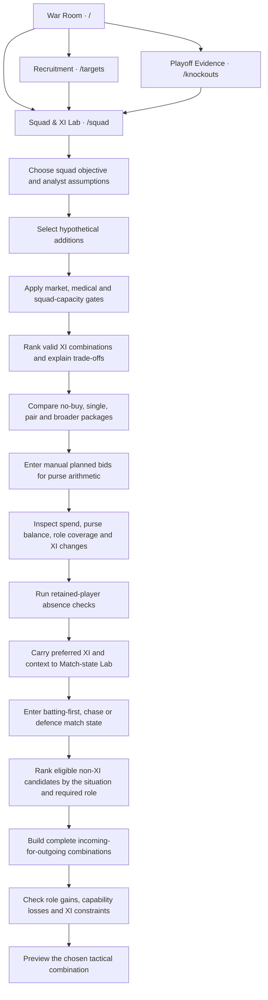

# Royals War Room — current product flow

**Current source package:** RR War Room historical-evidence engine pass  
**Snapshot basis:** 18 November 2026 RR squad and submitted SupeRR Selector report  
**Purpose:** explain how the current five-workspace application moves from evidence to squad decisions and match-state tactics.

## 1. The end-to-end flow

The five decision workspaces are connected by one decision story:

**Retained core → role gap → recruitment option → hypothetical squad → starting XI → match-state response**, with playoff evidence providing the historical context for the role-gap hypothesis. The separate Kadamba Spatial Lab is a research demonstration and does not join this decision chain.

## 2. Workspace-by-workspace behaviour

### 1. War Room — `/`

The landing workspace establishes the 18 November planning snapshot. It derives the retained-player count, overseas count, open squad places and squad-cap figures from the retained roster and domain constants; these are not static dashboard literals.

It frames the working hypothesis: RR should test protecting the existing core, selective Indian pace insurance / workload resilience (not an empty role), conditional specialist phase cover and a genuinely distinct middle/lower-order batter. The home page explicitly says this is a hypothesis to compare against broader packages, not a conclusion that RR must buy only one or two players.

The champion-continuity section now distinguishes **year-over-year auction retention** from **within-season XI stability**. It defines a fair comparison using distinct starters, average changes between consecutive match XIs and role continuity. Exact KKR/RR figures are withheld because the current app ZIP does not contain a complete, reconciled match-XI history for both campaigns.

### 2. Recruitment — `/targets`

This is the research and evidence workspace, not a “buy” button.

- Three workstreams organise the leading decision cases: selective pace insurance / workload resilience; specialist phase skill; and middle/lower-order batting only when it adds a distinct role.
- The complete directory exposes all **20** supplied candidate profiles, searchable by name, role, nationality and market status, with batter/bowler filters.
- Each profile separates role fit, supplied evidence, incremental value over the retained group, strongest counterargument, pressure exposure and status caveats.
- “Released · registration unverified” is visible as a research status, not treated as confirmed auction registration.
- Medical-review profiles remain conditional. A user-entered assumption permits only a hypothetical scenario; it is not medical clearance.

Market snapshot as of 21 November 2026: the official IPL released-player list confirms 19 of the 20 researched names as released (Mahipal Lomror is printed as “Mahipal Lamror” in the PDF and cross-checked against the official player profile). Daryl Mitchell remains market-unresolved and blocked. Release is not registration: the separate official “To Be Auctioned” page returned no player rows when checked, so these profiles remain provisional. Mangesh Yadav is listed under RCB, resolving the earlier report conflict. Matheesha Pathirana has a separate medical-review gate and requires an explicit high-risk hypothetical assumption; that assumption is not clearance.

### 3. Squad & XI Lab — `/squad`

This is the main strategy workbench.

1. Start with the 19 retained players and inspect the role distribution.
2. Select a planning objective: balanced, Indian pace depth, middle-order cover, spin control, injury resilience or specialist death option.
3. Set the venue and opposition profile. Venue is matched to an analyst-curated numeric ground ID where the archive has a complete canonical name/alias match. The opposition profile is an analyst input, not an automatically retrieved opposing XI. If sufficient player samples exist, the engine uses historical batter-vs-Pace/Spin or bowler-vs-LHB/RHB splits after shrinkage.
4. Keep the track selector at **Use historical venue/player evidence · no track inferred** by default. This is the neutral role-preference setting plus the sample-gated historical ground/player data. An optional slow, dry, dew, pace-friendly or bouncy override is a manual scenario assumption; the code does not infer a physical pitch from Wankhede, Chepauk or any other ground name.
5. Select the maximum number of changes from the six flexible reference-XI positions (0–6). The default is two. This is an analyst continuity policy, **not an IPL rule**. Core anchors are held unless marked unavailable.
6. Select zero to six hypothetical squad additions. The true constraints are the 25-player squad cap and eight-overseas squad cap; with the supplied 19-player / five-overseas baseline, there are six places and three extra overseas places.
7. Market-blocked candidates cannot be selected. A medical-review candidate needs a separate, explicitly labelled assumption. If a request exceeds the remaining capacity, the engine admits the valid partial package, reports the rejected/excess names and continues instead of returning an empty plan.
8. The optimizer enumerates role-valid XI assignments, ranks the combinations and shows up to three alternatives. Each plan shows the XI order, role counts, overseas count, reference changes, a transparent heuristic score breakdown, reasons, trade-offs and warnings.
9. The selected acquisition package is not forced into the starting XI. A selected recruit may remain hypothetical depth if the leading combinations are better without him. This is shown in the package-vs-XI panel and warnings.
10. The injury panel tests each retained player as unavailable and exposes real uncovered positions rather than inventing a replacement.
11. **Auction Strategy Simulator v1** compares the retained-only control, a single target, a two-player package and the current broader package. It uses the same domain engine and the published ₹27.05 crore purse snapshot. Enter manual planned bids for each accepted candidate; the screen calculates package spend, purse remaining and any over-purse warning, alongside role-tag changes, XI entrants/displacements, historical phase-sample strength and an absence stress test. It does not predict auction prices or calculate walk-away prices. Released but not auction-listed players remain explicitly not bid-ready.
12. **Use this XI** carries the XI, hypothetical additions, medical assumptions and selected scenario context into Match-state Lab.

The default reference core includes the top four and Archer as anchor roles; the flexible reference positions are 5, 6, 7, 8, 9 and 11. The engine is deterministic and role/constraint based. It is not a learned player-performance forecast.

### 4. Match-state Lab — `/match-lab`

The Match Lab restores the selected XI and package from Squad & XI Lab when they exist in the same browser session. It also restores the chosen objective, surface, opposition and XI-change policy. If no saved XI exists or it fails validation, it generates a fresh XI from the active package.

The analyst then selects a venue, surface assumption and opposition profile. The historical venue resolver accepts only a complete canonical ground name or curated alias; ambiguous partial strings such as a city-only label do not silently map to a stadium. Fourteen numeric venue IDs are mapped using repeated home-team concentration, not an official venue lookup table. Four other IDs stay unnamed. All 14 full labels shown in the venue dropdown are regression-checked against their intended numeric ID, including the full Chepauk display label. Ground-specific player splits are used only after at least 24 legal balls in 3 matches and are shrunk toward the player's wider phase evidence.

The surface selector defaults to historical venue/player evidence with a neutral role preference. It does **not** infer that Chepauk is slow or Wankhede bouncy. Slow/dry/dew/pace-friendly/bouncy settings are optional manual assumptions that affect broad role preferences. Opposition pace/spin or left-/right-hand profiles are also analyst assumptions; where samples are sufficient, they select descriptive phase splits, shrunk toward the player's broader phase record (at least 48 balls across 4 matches).

The analyst then selects one of three distinct innings modes:

- **RR batting first:** enter score, wickets and overs. A total objective is optional. With no total entered, the model does not infer a par score.
- **RR chasing:** enter RR score, wickets, overs and target. It calculates runs required, balls remaining and required rate.
- **RR defending:** enter the opponent score/wickets/overs and RR's defended total. It calculates what the opponent needs to win.

Overs use legal-ball notation (`10.3` = 63 balls; `10.6` and `20.1` are invalid). Score, wicket, overs and target fields are validated before a recommendation appears.

The venue remains analyst-entered unless a future verified fixture integration is built. Opponent selection never infers a venue. There is no live fixture, pitch, weather or player-matchup service. Historical player/ground and player/style splits are observations from the 2022–2026 archive, not current match conditions and not calibrated individual outcome forecasts.

The situation engine ranks only non-XI members of the active squad: retained players and explicitly selected hypothetical additions that pass the same market/medical gates. It considers innings mode, phase, wickets, score/current rate, target/required rate and role tags. It does not pull an unacquired player from the research directory into the current match squad.

Within five-point tactical role-fit bands, Match Lab uses one deterministic historical tie-break value assembled from match-grouped out-of-fold, venue-blind context residuals. For batters this is context-adjusted batter runs added per 100 legal batting balls; for bowlers it is context-adjusted batter runs prevented per 100 legal balls. Positive is favourable in each case. When an analyst selects a pace-/spin-heavy attack for batting or a left-/right-hand-heavy batting profile for defence, the player's own phase-specific split is shrunk toward their wider phase metric. If the mapped ground and minimum local exposure gate pass, the player's phase/ground split is then shrunk toward the style-adjusted phase prior. A single combined metric is used both for sorting and display; missing evidence does not penalise a player.

This is descriptive comparative evidence, not a calibrated prediction. The model's 2026 chronological holdout improves RMSE by about 1.08% against a simple phase/innings/pace-spin mean but has about 1.07% worse MAE. Adding venue ID to the model did not improve holdout performance. Accordingly, venue splits are not claimed as a predictive pitch effect.

The recommendation is a **squad-pool tactical candidate**, not confirmation of official match-day nomination or eligibility. Confirm the official team sheet and applicable 2027 playing conditions before using it.

The starting XI is displayed as exactly eleven connected player cards. The Impact Player is not a permanent twelfth slot in the team sheet. For each match state, the Match Lab builds one-for-one incoming-for-outgoing combinations: it pairs an eligible non-XI candidate with a current starter selected by role-coverage checks. The before/after audit reports batting, wicketkeeping, pace, spin, overseas, specialist death and left-arm pace counts, capability additions/losses and structural warnings. Each preview must retain exactly 11 unique players, at least one identified wicketkeeper, two pace-role options, one spin-role option and no more than four overseas players. Each card explains the match trigger, supplied incoming role profile, historical phase tie-break sample/confidence where available, why the outgoing player is selected and what capability the XI gives up. Role tags are listed coverage only; they do not establish specialist overs or like-for-like execution. It is a local scenario preview, not a saved or official team change.

### 5. Playoff Evidence — `/knockouts`

This workspace contains seven RR playoff scorecard records across 2022, 2024 and 2026. The detailed phase comparison is limited to the three supplied investigations: 2022 Final, 2024 Qualifier 2 and 2026 Qualifier 2.

The phase values are labelled **batter-run components**, not official phase totals, because the supplied delivery export stores categorical extras. The narrative distinguishes RR middle-over wicket clusters in the 2022 Final and 2024 Q2 from GT's 2026 Q2 middle-phase partnership control. The 2026 Eliminator is retained as evidence of the batting group's upside. These observations inform questions; they do not prove a hypothetical recruit would have changed a historical result.

## 3. What the decision engine actually enforces

| Rule | Current behaviour |
|---|---|
| Retained baseline | 19 players; five overseas in the supplied snapshot |
| Full squad | Maximum 25; six open places in the supplied snapshot |
| Overseas squad | Maximum 8; three extra places in the supplied snapshot |
| Starting XI | Exactly 11 distinct players from the active hypothetical squad |
| Overseas XI | Maximum 4 |
| Role floor | At least 2 supplied pace-role options and 1 supplied spin-role option |
| Squad package | 0–6 additions, limited by actual remaining squad/overseas capacity |
| Continuity policy | 0–6 allowed changes among six flexible reference positions; default 2; not a league rule |
| Market/medical | Unresolved/ineligible profiles fail closed; medical-review profiles need an explicit assumption |

The scorecard components are positional fit, continuity, bowling balance, batting depth, objective fit, overseas opportunity cost and acquisition complexity. These are transparent heuristic points for comparing plans under the same assumptions. They are not calibrated probabilities, player ratings, expected runs, win probabilities or a validated optimization objective.

## 4. What state carries between workspaces

The application uses browser `sessionStorage`, not a server database or permanent user profile. The following keys connect Squad & XI Lab to Match Lab:

- `rr-wr-selected-xi`
- `rr-wr-selected-acquisitions`
- `rr-wr-medical-assumptions`
- `rr-wr-selected-context` (objective, surface, opposition and maximum XI changes)
- `rr-wr-selected-plan-label`
- `rr-wr-match-venue`

Data is restored only if it still passes the current package, market, medical, size and uniqueness checks. Closing the browser session, clearing site data or using another browser/device may remove it. The Playoff Evidence and Recruitment workspaces are research views and do not mutate the squad package.

### 6. Kadamba Spatial Lab — `/spatial-lab`

This is a separate experimental research workspace. It contains a 5×5 descriptive landing-zone grid, observed batter-run and bowler-credited wicket rates, and aggregate out-of-fold expected-run / wicket outputs from a context-only and context-plus-location LightGBM comparison. The default view shows context + location predictions. Values for a selected cell are averages of held-out predictions for observed deliveries that actually landed in that cell—not an intervention prediction for deliberately bowling the next ball there.

The supplied tracking source has 149,424 deliveries across 628 match IDs; the filtered sample contains 135,587 legal main-innings deliveries across 627 matches. Zone counts reconcile exactly across 25 cells. The model is three-fold GroupKFold by match, with 1,000 match-cluster bootstrap resamples over existing OOF predictions (no model refit). Batter-run MAE improves about 1.025%; wicket AP improves by 0.00637 absolute. The improvement is modest and remains untested chronologically.

The lab is intentionally not connected to recruitment, pressure rankings, Match-State/Impact Player, or the 2022–2026 RR squad archive. The source CSV has no reliable dates, seasons, teams, venues or player crosswalk. “Kadamba” is a project display name; L/Y labels remain neutral because axis orientation is not confirmed. The underlying CSV is not redistributed in the ZIP. See `docs/audits/SPATIAL_MODEL_PILOT.md` and `docs/audits/SPATIAL_RELEASE_VALIDATION.md`.

## 7. Explicit non-features / limits

- No live auction registration feed. Released does not mean registered; the simulator uses a dated official source snapshot and manual source re-check before any real bid.
- No medical clearance, injury diagnosis or return-to-play forecast. A medical checkbox is only a hypothetical assumption.
- No auction price prediction, price-calibration or walk-away model; the Auction Strategy Simulator uses manual planned-bid inputs for purse arithmetic only. No price is inferred from prior salary or performance statistics.
- No live venue fixture lookup, official venue-name dimension, pitch report, weather, dew or ball-condition feed.
- No calibrated live next-ball forecast, player-specific spatial model, win probability or player-vs-opponent outcome prediction. The isolated Kadamba Spatial Lab is only an experimental historical tracking demonstration and does not feed other app decisions. The embedded historical context model is only used to create player-level comparative residuals for a close-role tie-break.
- No state-conditioned Impact Player-choice model. The source archive records incoming/outgoing flags (IPL 2023–2026) but does not include exact substitution timestamp, score, wickets, phase or nominated alternatives. Those flags appear as descriptive player usage only.
- No DLS/revised-target model.
- No verified official Impact Player nomination/team-sheet check.
- No server-side account persistence or multi-user scenario database.

These limits are visible in the product and must remain visible in any later redesign.

## War Room home — season-to-gap narrative (21 November 2026)

The home screen is ordered as a decision story:

1. **Five-season comparison:** IPL 2022–2026 league-stage positions and records, with playoff route/final tournament placement shown separately.
2. **Playoff conversion:** the three playoff campaigns and seven matches (three wins, four defeats), followed by the detailed scorecard/phase page.
3. **Gap finder:** the playoff cases are tested against the 19 retained players' roles and the XI engine's absence stress tests. pace role redundancy, middle-order innings repair and cover are separated; overlap areas are called out to prevent duplicate purchases.
4. **Recruitment and squad build:** inspect candidate evidence and market gates, compare no-buy/one-player/multi-player packages, then rebuild the legal XI.
5. **Match-state Lab:** test batting-first, chase and defence scenarios using situation-based, explainable role/constraint logic.
6. **Kadamba Spatial Lab:** inspect the independent 25-zone historical tracking demonstration and model comparison without treating it as RR-specific tactical advice.

League-stage records are sourced from the official RR history page and always use the same 14-match league basis. Post-season records are kept separate; 2026 is fourth in the league phase and third overall after the knockout route. Full season-row data definitions and aggregate checks are in `docs/season-review-methodology.md`.
