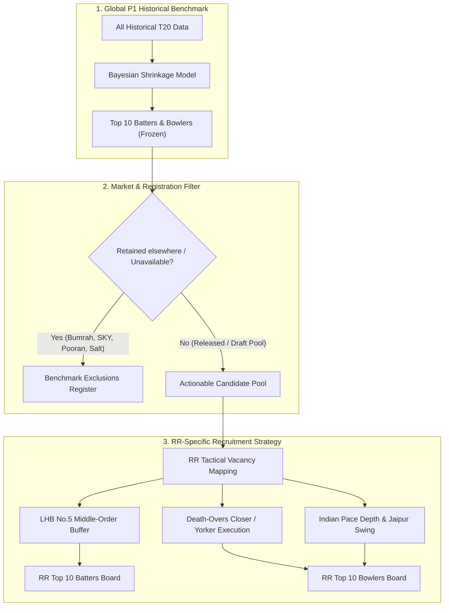
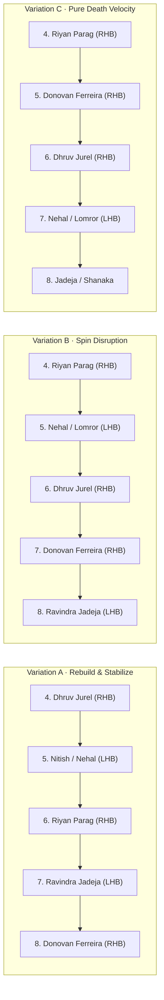
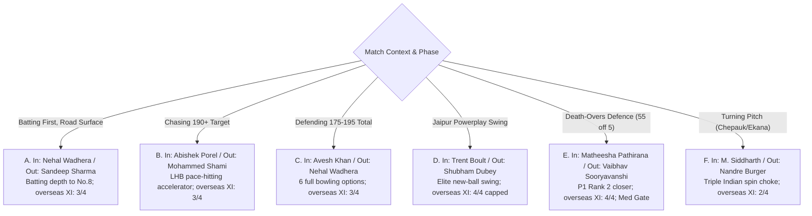
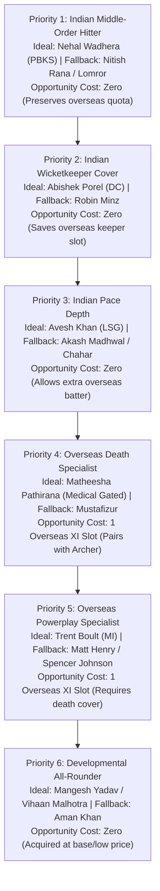

# Rajasthan Royals IPL 2027 Auction Recruitment Strategy & Pressure Analytics Report

**Authoritative Technical Briefing for Rajasthan Royals Auction War Room**  
_Snapshot Date: 18 November 2026_  
_Initial Purse Remaining: ₹27.05 Crore_  
_Total Retained Players: 19 (5 Overseas, 14 Indian)_  
_Squad Vacancies: 6 (Maximum 3 Overseas)_

---

## Executive Summary & Foundational Distinction

A critical domain integrity correction has been executed across the Rajasthan Royals analytics infrastructure. Historical P1 performance rankings measure how players performed relative to match context expectations across historical T20 samples; they do **not** independently establish auction eligibility, contract availability, or recruitment priority for Rajasthan Royals.

To eliminate confusion, the decision-support engine enforces three strictly isolated concepts:

1. **Global Historical P1 Benchmark**: Frozen historical ranking measuring contextual execution across broad T20 datasets.
2. **RR-Specific Pressure-Informed Recruitment Rankings**: Exactly 10 batters and 10 bowlers selected and ranked to solve Rajasthan Royals' specific squad vacancies, knockout diagnostics, and tactical balance.
3. **Auction Market & Registration Status**: Authoritative classification establishing whether a candidate is released, an expected entrant, retained elsewhere, medically gated, or legally unavailable.

---

## Part 1: RR-Specific Batter Recruitment Board (Top 10)

These 10 candidates are ranked specifically for RR's auction priorities. The primary target area is an Indian left-handed middle-order buffer at No. 5 between Dhruv Jurel (No. 4) and Donovan Ferreira (No. 6), solving the middle-over spin squeeze that eliminated RR in the 2024 Qualifier 2.

|  Rank  | Candidate            | Primary Role                | Secondary Role              | Nationality | Market / Medical Status       |     Pressure Evidence Status      |
| :----: | :------------------- | :-------------------------- | :-------------------------- | :---------: | :---------------------------- | :-------------------------------: |
| **01** | **Nehal Wadhera**    | FLOATER                     | LOWER_MIDDLE_ORDER_FINISHER |   Indian    | Released by PBKS · Unverified |   PROVISIONAL (59 gated balls)    |
| **02** | **Abishek Porel**    | WICKETKEEPER_BATTER         | FLOATER                     |   Indian    | Released by DC · Unverified   |    IPL Descriptive (SR 152.4)     |
| **03** | **Nitish Rana**      | MIDDLE_ORDER_ANCHOR         | FLOATER                     |   Indian    | Released by KKR · Unverified  |    107 IPL Matches (135.2 SR)     |
| **04** | **Mahipal Lomror**   | BATTING_ALL_ROUNDER         | LOWER_MIDDLE_ORDER_FINISHER |   Indian    | Released by RCB · Unverified  | SMS Jaipur Familiarity (SR 141.2) |
| **05** | **Shimron Hetmyer**  | OVERSEAS_POWER_HITTER       | LOWER_MIDDLE_ORDER_FINISHER |  Overseas   | Released by RR · Unverified   | P1 Rank 72 (322 IPL death balls)  |
| **06** | **Robin Minz**       | WICKETKEEPER_BATTER         | LOWER_MIDDLE_ORDER_FINISHER |   Indian    | Released by GT · Unverified   | Domestic Power Outlier (SR >165)  |
| **07** | **Kamindu Mendis**   | BATTING_ALL_ROUNDER         | FLOATER                     |  Overseas   | Int'l Entrant · Unverified    |   Ambidextrous Spin (Off + SLA)   |
| **08** | **Aman Khan**        | LOWER_MIDDLE_ORDER_FINISHER | BATTING_ALL_ROUNDER         |   Indian    | Released by CSK · Unverified  |  Domestic SMAT Power (SR 158.4)   |
| **09** | **Vihaan Malhotra**  | DEVELOPMENTAL_BATTER        | FLOATER                     |   Indian    | Released by RCB · Unverified  | U19 WC Star (109*); SMAT Nov '26  |
| **10** | **Matthew Breetzke** | OVERSEAS_POWER_HITTER       | MIDDLE_ORDER_ANCHOR         |  Overseas   | Released by LSG · Unverified  |  SA20 Top-Order Power (SR 142.6)  |

### Detailed Candidate Dossiers

#### 1. Nehal Wadhera (Rank 01 · India)

- **Why RR?**: Direct structural fix for RR's critical missing link: an Indian left-handed middle-order buffer at No. 5 between Jurel (No. 4) and Ferreira/Jadeja (Nos. 6–7). Prevents the middle-over spin choke that derailed RR in the 2024 Qualifier 2.
- **Pressure Evidence**: _PROVISIONAL LOW SAMPLE_. 59 pressure-gated deliveries in the archive (below the 100-ball threshold). Evaluated on 36 IPL matches, 538 legal deliveries, 139.59 strike rate, and 36.99% dot ball percentage.
- **Role Fit**: Natural LHB innings-repairer who floats between Nos. 4 and 6 depending on game state.
- **Upgrade Over Current Squad**: Provides a specialist left-handed middle-order anchor/floater, relieving Shubham Dubey from bearing the entire domestic middle-order burden and allowing Donovan Ferreira to enter in his optimal death-overs window.
- **Watch-Out**: _IPL 2026 production slumped compared to 2025; sample is below the 100-ball P1 threshold and he will command aggressive multi-team bidding._

#### 2. Abishek Porel (Rank 02 · India)

- **Why RR?**: High-impact domestic wicketkeeping cover behind Dhruv Jurel while functioning as a dynamic left-handed batting floater. Securing Porel eliminates the need to spend an overseas XI slot on backup keeper Lhuan-dre Pretorius.
- **Pressure Evidence**: _P1 NOT AVAILABLE IN ARCHIVE_. Supported by verified IPL descriptive sample: 28 matches, 500+ runs, strike rate 152.4.
- **Role Fit**: Aggressive powerplay/middle-overs LHB floater and sharp wicketkeeper.
- **Upgrade Over Current Squad**: Unlocks tactical flexibility, enabling Jurel to play as a pure batter when workload requires.
- **Watch-Out**: _Historical sample is concentrated in top-order overs (Nos. 1–3); he is NOT a proven death-overs power hitter and must not be deployed as a No. 6–7 finisher._

#### 3. Nitish Rana (Rank 03 · India)

- **Why RR?**: Seasoned left-handed stabilizer who provides collapse insurance (e.g. 2022 Final against GT). Excellent middle-overs boundary scoring against spin (overs 7–15) and handy off-spin bowling against left-handers.
- **Pressure Evidence**: _P1 NOT AVAILABLE IN ARCHIVE_. Backed by 107 IPL appearances, 2,636 runs, 18 half-centuries, and 10 seasons of high-leverage playoff experience.
- **Role Fit**: Operates at Nos. 3–5 to absorb pressure and counter left-arm orthodox or leg-spin.
- **Upgrade Over Current Squad**: Provides seasoned tactical maturity that young Vaibhav Sooryavanshi and Shubham Dubey do not yet possess in knockout matches.
- **Watch-Out**: _Not an explosive No. 7 finisher; scoring velocity decelerates against high-pace back-of-a-length bowling (>142 kph) at the death._

#### 4. Mahipal Lomror (Rank 04 · India)

- **Why RR?**: Former Royal with deep familiarity with Sawai Mansingh Stadium pitch dimensions. Provides explosive middle-overs boundary striking against spin and handy left-arm orthodox bowling.
- **Pressure Evidence**: _P1 NOT AVAILABLE IN ARCHIVE_. Evaluated through 40 IPL matches with RCB and RR (strike rate vs spin: 158.6; overall: 141.2).
- **Role Fit**: Middle-overs spin-disruptor deployed at Nos. 5–7.
- **Upgrade Over Current Squad**: Domestic left-handed alternative offering secondary spin cover for Ravindra Jadeja at affordable auction pricing.
- **Watch-Out**: _Prone to short-ball dismissals against express pace; finishing consistency in tight chases remains volatile._

#### 5. Shimron Hetmyer (Rank 05 · Overseas · West Indies)

- **Why RR?**: Direct buyback comparator who understands RR's setup. Proven death-overs boundary pedigree (322 legal death balls in IPL, 1.863 runs/ball).
- **Pressure Evidence**: _ELIGIBLE P1 ARCHIVE_. Archived P1 Rank 72. 251 gated balls across 36 matches (81% IPL share). Below elite pressure tier, but elite IPL-specific death volume.
- **Role Fit**: Specialist No. 6 power finisher and boundary accelerator in overs 16–20.
- **Upgrade Over Current Squad**: Established match-winning pedigree for RR; contingency if Donovan Ferreira experiences injury or form slump.
- **Watch-Out**: _Consumes an overseas XI slot. Because RR already retains Donovan Ferreira as primary overseas finisher, signing Hetmyer restricts overseas bowling combinations (Archer + Pathirana/Boult/Burger)._

#### 6. Robin Minz (Rank 06 · India)

- **Why RR?**: High-ceiling domestic talent: left-handed wicketkeeper-finisher with exceptional natural bat speed. Acquirable at low purse cost.
- **Pressure Evidence**: _P1 NOT AVAILABLE IN ARCHIVE_. Domestic T20 strike rate >165 with raw bat-speed metrics.
- **Role Fit**: Natural lower-middle-order finisher (Nos. 6–7) and backup keeper.
- **Upgrade Over Current Squad**: Adds explosive domestic LHB power without burning an overseas slot or competing for Jurel's top-order position.
- **Watch-Out**: _Zero senior IPL match caps; unproven against international express pace and elite death-overs yorkers._

#### 7. Kamindu Mendis (Rank 07 · Overseas · Sri Lanka)

- **Why RR?**: Ambidextrous tactical weapon: bats middle order with classical composure, while bowling right-arm off-spin to LHBs and left-arm orthodox to RHBs. Gives RR complete matchup dominance.
- **Pressure Evidence**: _P1 NOT AVAILABLE IN ARCHIVE_. Outstanding international Test and T20 record under pressure (ICC breakout performer 2024–2026).
- **Role Fit**: Middle-order floater (Nos. 4–6) and dual-matchup bowler.
- **Upgrade Over Current Squad**: Unmatched tactical flexibility in a single player slot.
- **Watch-Out**: _Zero prior IPL tournament experience; consumes 1 of only 4 available overseas XI slots._

#### 8. Aman Khan (Rank 08 · India)

- **Why RR?**: Imposing Indian seam-bowling power hitter who hits straight down the ground at Nos. 6–7 and bowls 1–2 overs of medium pace, reducing reliance on Dasun Shanaka's overseas slot.
- **Pressure Evidence**: _P1 NOT AVAILABLE IN ARCHIVE_. Domestic SMAT strike rate 158.4 across 42 matches.
- **Role Fit**: Lower-order boundary hitter and sixth-bowler seamer.
- **Upgrade Over Current Squad**: Affordable domestic seam-bowling batter giving tactical bench depth.
- **Watch-Out**: _Sporadic IPL production; vulnerable to sharp chest-high short deliveries._

#### 9. Vihaan Malhotra (Rank 09 · India)

- **Why RR?**: Blue-chip developmental asset: 2026 India U19 World Cup standout (109* vs Zimbabwe, 4/14 vs Bangladesh) and dominant SMAT form in Nov 2026 (86 off 50 vs Haryana). Ideal developmental peer for Vaibhav Sooryavanshi.
- **Pressure Evidence**: _P1 NOT AVAILABLE IN ARCHIVE_. Outstanding junior/domestic metrics: 256 runs off 143 balls (SR 179.02) in Sher-e-Punjab T20.
- **Role Fit**: Left-handed top/middle-order floater with right-arm off-spin.
- **Upgrade Over Current Squad**: Adds elite age-group pedigree and left-handed batting depth for the 2027–2030 cycle at base price.
- **Watch-Out**: _Raw youth; completely unproven against senior international bowling in high-pressure IPL atmospheres._

#### 10. Matthew Breetzke (Rank 10 · Overseas · South Africa)

- **Why RR?**: High-pace back-foot aggressor who has excelled in SA20. Provides top/upper-middle-order insurance if Jaiswal, Vaibhav, or Parag suffer injuries.
- **Pressure Evidence**: _P1 NOT AVAILABLE IN ARCHIVE_. SA20 strike rate 142.6 with 18.8% boundary percentage.
- **Role Fit**: Top-order power batter (Nos. 1–3) against 145+ kph pace.
- **Upgrade Over Current Squad**: Elite overseas top-order batting cover.
- **Watch-Out**: _Positional clash with Vaibhav, Jaiswal, and Parag. He is NOT a natural No. 5–8 finisher and must not be recruited for death-hitting roles. Evaluated against Mitch Owen (PBKS release; unproven IPL pressure sample) and Michael Bracewell (not in supplied release register)._

---

## Part 2: RR-Specific Bowler Recruitment Board (Top 10)

These 10 bowlers are ranked specifically to address Rajasthan Royals' bowling vulnerabilities: high-leverage death execution (overs 17–20), powerplay swing at Jaipur, and domestic pace depth to manage Mohammed Shami's workload.

|  Rank  | Candidate               | Primary Role         | Secondary Role       | Nationality | Market / Medical Status      |          Pressure Evidence Status          |
| :----: | :---------------------- | :------------------- | :------------------- | :---------: | :--------------------------- | :----------------------------------------: |
| **01** | **Matheesha Pathirana** | DEATH_SPECIALIST     | EXPRESS_PACE         |  Overseas   | Released by KKR · Unverified | **P1 Rank 2** (-12.38/100, 83.8% P(top10)) |
| **02** | **Trent Boult**         | POWERPLAY_SPECIALIST | NEW_BALL_PACE        |  Overseas   | Released by MI · Unverified  | **P1 Rank 8** (-6.89/100, 61.2% PP share)  |
| **03** | **Avesh Khan**          | PACE_ENFORCER        | INDIAN_PACE_DEPTH    |   Indian    | Released by LSG · Unverified |      Ex-RR (19 wkts in '24; 142+ kph)      |
| **04** | **Mustafizur Rahman**   | VARIATION_SPECIALIST | DEATH_SPECIALIST     |  Overseas   | Released by KKR · Unverified | **P1 Rank 5** (-8.22/100, 206 death balls) |
| **05** | **Akash Madhwal**       | INDIAN_PACE_DEPTH    | DEATH_SPECIALIST     |   Indian    | Released by CSK · Unverified |  Ex-RR 2025; 106 death balls (10.30 econ)  |
| **06** | **Matt Henry**          | POWERPLAY_SPECIALIST | NEW_BALL_PACE        |  Overseas   | Released by CSK · Unverified |    NZ Seam Master (6/27 ODI form noted)    |
| **07** | **Gerald Coetzee**      | EXPRESS_PACE         | PACE_ENFORCER        |  Overseas   | Released by MI · Unverified  |   145+ kph Hostility (13 wkts in 10 IPL)   |
| **08** | **Mangesh Yadav**       | INDIAN_PACE_DEPTH    | VARIATION_SPECIALIST |   Indian    | Released by RCB · Unverified | Domestic LHB/LAM All-Rounder (₹5.2 Cr '26) |
| **09** | **Deepak Chahar**       | POWERPLAY_SPECIALIST | NEW_BALL_PACE        |   Indian    | Released by CSK · Unverified |      81 IPL Matches (7.74 PP economy)      |
| **10** | **Spencer Johnson**     | EXPRESS_PACE         | POWERPLAY_SPECIALIST |  Overseas   | Released by GT · Unverified  |       145+ kph Left-Arm Steep Bounce       |

### Detailed Candidate Dossiers

#### 1. Matheesha Pathirana (Rank 01 · Overseas · Sri Lanka)

- **Why RR?**: Direct statistical cure for RR's biggest failure mode: death-overs execution (which cost RR Qualifier 2 in 2026). Partnering Pathirana with Jofra Archer creates the most destructive pace pairing in the tournament.
- **Pressure Evidence**: _ELIGIBLE P1 ARCHIVE_. **P1 Rank 2 overall**. Bayesian posterior mean of -12.38 runs/100 conceded relative to context expectation with 83.8% probability of being a top-10 pressure bowler. 302 IPL death deliveries, 8.80 economy, 8.55 wickets/100 balls, and 88 recorded yorkers.
- **Role Fit**: Elite death-overs closer operating in overs 15, 17, 19, and 20.
- **Upgrade Over Current Squad**: Transformational upgrade over Sandeep Sharma and Nandre Burger at the death, shifting Sandeep to an off-pace control role and freeing Archer for flexible middle/powerplay overs.
- **Watch-Out**: _HARD MEDICAL RESTRICTION. Left hamstring surgery in 2026; cannot be treated as an unconditional acquisition until independent medical evaluation confirms full 145+ kph bowling workload._

#### 2. Trent Boult (Rank 02 · Overseas · New Zealand)

- **Why RR?**: Proven master of Jaipur's Sawai Mansingh Stadium powerplay conditions. Reconstitutes the lethal Boult-Archer-Shami new-ball triumvirate that dismantled top orders across the IPL.
- **Pressure Evidence**: _ELIGIBLE P1 ARCHIVE_. **P1 Rank 8 bowler**. Posterior mean of -6.89 runs/100 with 85% IPL share in gated pressure sample. Dedicated powerplay strike bowler (61.2% of delivery volume in overs 1–6).
- **Role Fit**: Front-loaded powerplay wicket-taker attacking with early swing.
- **Upgrade Over Current Squad**: Elite left-arm swing angle that Nandre Burger cannot match in early lateral movement, setting up high-probability powerplay wickets.
- **Watch-Out**: _NOT A DEATH BOWLER (only 17.3% death usage). Form slumped in IPL 2026 (11.63 economy); consumes an overseas XI slot without solving the 18–20 over death phase._

#### 3. Avesh Khan (Rank 03 · India)

- **Why RR?**: Vital Indian pace enforcer who knows RR's setup intimately (19 wickets in RR's 2024 campaign). Bowling 142+ kph hard lengths through middle and death overs frees up an overseas slot for an extra batter.
- **Pressure Evidence**: _P1 NOT AVAILABLE IN ARCHIVE_. Supported by extensive IPL playoff workload for RR (19 wickets in 2024, heavy death-overs duty).
- **Role Fit**: Hit-the-deck Indian fast bowler capable across all three phases (1 PP, 2 middle, 1 death).
- **Upgrade Over Current Squad**: Massive upgrade in proven high-intensity experience over domestic reserves Brijesh Sharma and Sushant Mishra; shields Shami from heavy death-overs load.
- **Watch-Out**: _Death execution can leak boundaries when radar slips; 2025/2026 IPL economy oscillated above 9.2 rpo; not an automatic first-choice frontline closer._

#### 4. Mustafizur Rahman (Rank 04 · Overseas · Bangladesh)

- **Why RR?**: Direct tactical contingency for Pathirana: brings deceptive off-pace cutters and dipping slower deliveries that grip on slower Jaipur surfaces, offering a stark contrast to Archer's express pace.
- **Pressure Evidence**: _ELIGIBLE P1 ARCHIVE_. **P1 Rank 5 bowler**. Concedes -8.22 runs/100 relative to expectation across 554 gated balls. 206 IPL death deliveries with 10.28 economy and 6.70 wickets/100 balls.
- **Role Fit**: Phase-flexible variation bowler operating in overs 17 and 19.
- **Upgrade Over Current Squad**: Seasoned left-arm variation specialist who excels on dry, gripping surfaces where Burger's raw pace would sit up.
- **Watch-Out**: _Do NOT equate him to Pathirana: death economy (10.28) is significantly higher than Pathirana (8.80) and 90% posterior interval includes zero (0.89)._

#### 5. Akash Madhwal (Rank 05 · India)

- **Why RR?**: Ex-RR squad member (IPL 2025, then CSK replacement in 2026) with skiddy, low-release trajectory that makes his yorkers difficult to get under. Affordable Indian pace reinforcement.
- **Pressure Evidence**: _P1 NOT AVAILABLE IN ARCHIVE_. Supported by 106 IPL death deliveries with strong strike rate (6.72 wkts/100) and 23 career IPL wickets.
- **Role Fit**: Middle-and-death phase bowler with low release point.
- **Upgrade Over Current Squad**: Gives RR a specialist Indian yorker option on the bench without paying premium auction prices, preserving purse for top-tier targets.
- **Watch-Out**: _Economy rate at death (10.30) can be expensive on good batting tracks; limited powerplay utility._

#### 6. Matt Henry (Rank 06 · Overseas · New Zealand)

- **Why RR?**: In blazing current form (took 6/27 vs India in the 13 Nov 2026 ODI). Delivers impeccable upright seam presentation that extracts movement on spicy, green, or hard surfaces.
- **Pressure Evidence**: _P1 NOT AVAILABLE IN ARCHIVE_. **METHODOLOGY SEPARATION**: His recent 6/27 ODI figures against India are current-form indicators only; they are strictly **NOT** T20 pressure evidence and must **NOT** enter P1.
- **Role Fit**: New-ball powerplay strike bowler who hits the seam relentlessly in overs 1–6.
- **Upgrade Over Current Squad**: High-class overseas new-ball alternative if bidding for Trent Boult exceeds disciplined ceilings.
- **Watch-Out**: _High role overlap with Mohammed Shami and Jofra Archer; limited death-overs execution; consumes an overseas XI slot._

#### 7. Gerald Coetzee (Rank 07 · Overseas · South Africa)

- **Why RR?**: Genuine 145+ kph hostility and aggression. Provides a hit-the-deck express enforcer who can intimidate middle orders with bouncers and heavy lengths.
- **Pressure Evidence**: _P1 NOT AVAILABLE IN ARCHIVE_. Evaluated through 10 IPL matches with MI (13 wickets, strike rate 15.6 balls/wicket).
- **Role Fit**: Middle-overs strike bowler and enforcer.
- **Upgrade Over Current Squad**: Adds sheer intimidation factor and high pace alongside Jofra Archer, overwhelming opponents who struggle against high heat.
- **Watch-Out**: _Leaky economy rate (career IPL economy 10.18); frequently concedes boundary balls when attempting bouncers; consumes overseas slot._

#### 8. Mangesh Yadav (Rank 08 · India)

- **Why RR?**: Rare domestic left-arm fast bowler with lower-order batting capability. Commanded ₹5.2 Crore in the 2026 auction; stellar MP T20 2025 campaign (14 wickets in 21 overs at 8.00 economy).
- **Pressure Evidence**: _P1 NOT AVAILABLE IN ARCHIVE_. Domestic MP T20 evidence: 14 wickets in 21 overs at 8.00 economy in 2025; 4 wickets in 21 overs at 10.67 economy in 2026.
- **Role Fit**: Domestic Indian pace-bowling depth and developmental left-arm option for succession planning.
- **Upgrade Over Current Squad**: Provides a left-arm pace angle from an Indian slot, enabling RR to field an extra overseas batter if desired.
- **Watch-Out**: _Zero senior IPL match experience; economy ballooned to 10.67 in 2026 MP T20; not a proven death bowler._

#### 9. Deepak Chahar (Rank 09 · India)

- **Why RR?**: Elite domestic powerplay swing bowler with extensive championship-winning pedigree. Provides early wickets and useful lower-order hitting at No. 8, saving an overseas slot.
- **Pressure Evidence**: _P1 NOT AVAILABLE IN ARCHIVE_. Backed by 81 IPL matches (77 wickets, 7.97 economy) and lifetime IPL powerplay economy under 7.8.
- **Role Fit**: Front-loaded powerplay bowler (typically bowls 3 of the first 6 overs).
- **Upgrade Over Current Squad**: Enables an all-Indian new-ball attack (Chahar + Shami) alongside Archer, unlocking two overseas batting slots (Ferreira + Shanaka/Hetmyer).
- **Watch-Out**: _Fragile injury history (recurrent hamstring, back, and quadriceps issues); minimal effectiveness outside the first 6 overs._

#### 10. Spencer Johnson (Rank 10 · Overseas · Australia)

- **Why RR?**: High-release 145+ kph left-arm express pace capable of extracting steep bounce. Natural left-arm pace alternative to Nandre Burger.
- **Pressure Evidence**: _P1 NOT AVAILABLE IN ARCHIVE_. Evaluated through BBL and IPL 2024 appearances (high dot-ball percentage against top orders; BBL economy 7.15).
- **Role Fit**: Powerplay and middle-overs strike bowler; utilizes high arm action and speed.
- **Upgrade Over Current Squad**: Offers left-arm express pace depth if Nandre Burger experiences fatigue or tactical matchups demand extra bounce.
- **Watch-Out**: _Consumes an overseas XI slot; recurring soft-tissue injuries; death bowling at IPL level remains volatile._

---

## Part 3: Global P1 Benchmark Exclusions

The following 18 players are excluded from Rajasthan Royals' actionable auction recruitment lists. While their historical performance appears in the P1 model or public references, contractual, franchise, or availability realities preclude their acquisition.

| Player                | Global P1 Rank | Discipline | Franchise / Status                     | Exclusion Reason                                                                         | Pressure Score / 100 |
| :-------------------- | :------------: | :--------: | :------------------------------------- | :--------------------------------------------------------------------------------------- | :------------------: |
| **Jasprit Bumrah**    |       1        |   Bowler   | Mumbai Indians (Retained)              | Retained by MI; contractually unavailable for auction acquisition.                       |        -19.32        |
| **Yashasvi Jaiswal**  |       2        |   Batter   | Rajasthan Royals (Retained)            | Core retained asset for RR; cannot be re-acquired at auction.                            |        +26.68        |
| **Tim David**         |       1        |   Batter   | Royal Challengers Bengaluru (Retained) | Retained by RCB for IPL 2027; legally unavailable.                                       |        +27.97        |
| **Abhishek Sharma**   |       3        |   Batter   | Sunrisers Hyderabad (Retained)         | Retained by SRH; not in auction pool. Status unresolved in historical benchmark.         |        +23.94        |
| **Suryakumar Yadav**  |       4        |   Batter   | Mumbai Indians (Retained)              | Retained by MI; contractually locked.                                                    |        +23.67        |
| **Nicholas Pooran**   |       5        |   Batter   | Lucknow Super Giants (Retained)        | Retained by LSG for ₹21 Cr; unavailable for auction recruitment.                         |        +17.97        |
| **Phil Salt**         |       6        |   Batter   | Royal Challengers Bengaluru (Retained) | Retained by RCB; contractually unavailable.                                              |        +17.38        |
| **Haris Rauf**        |       3        |   Bowler   | Pakistan (Unresolved / T20I Only)      | 0% IPL share in pressure sample; Pakistan player not participating in IPL auction.       |        -10.62        |
| **Sunil Narine**      |       6        |   Bowler   | Kolkata Knight Riders (Retained)       | Retained by KKR; contractually locked.                                                   |        -7.25         |
| **Lungi Ngidi**       |       7        |   Bowler   | Delhi Capitals (Retained)              | Retained by DC; contractually unavailable.                                               |        -7.03         |
| **Bhuvneshwar Kumar** |       9        |   Bowler   | Royal Challengers Bengaluru (Retained) | Retained by RCB; contractually unavailable.                                              |        -6.78         |
| **Shaheen Afridi**    |       10       |   Bowler   | Pakistan (Unresolved / T20I Only)      | 0% IPL share in pressure sample; non-participant in IPL auction.                         |        -5.97         |
| **Jacob Bethell**     |      N/A       |   Batter   | Royal Challengers Bengaluru (Released) | Confirmed unavailable for IPL 2027 following right-knee surgery setback. Hard exclusion. |         0.00         |
| **Mitchell Starc**    |      N/A       |   Bowler   | Delhi Capitals (Released)              | Reported workload opt-out for IPL 2027 due to Australian international schedule.         |         0.00         |
| **MS Dhoni**          |      N/A       |   Batter   | Chennai Super Kings (Retired)          | Retired from active IPL playing to assume CSK mentor role.                               |         0.00         |
| **Andre Russell**     |       8        |   Batter   | Retired / Mentor Transition            | Historical P1 benchmark only; inactive in competitive auction market.                    |        +17.32        |
| **Tushar Deshpande**  |      N/A       |   Bowler   | Rajasthan Royals (Released)            | Explicitly excluded by competition mandate; release indicates tactical departure.        |         0.00         |
| **M Shahrukh Khan**   |       64       |   Batter   | Gujarat Titans (Released)              | Explicitly excluded by competition mandate; redundant No.6–7 profile overlaps Ferreira.  |        -0.12         |

---

## Part 4: Tactical Middle-Order Flexibility Matrix (Slots 4–8)

RR's 2024/2026 playoff defeats were characterized by inflexible middle-order batting against spin and sudden collapses. The strategy engine provides three distinct tactical variations for slots 4–8.

### Detailed Variations

1. **Variation A — Early Wickets Lost (Stabilization & Rebuild)**:
   - _Context_: Top-order wickets lost in the powerplay (e.g. 25/2 in overs 1–4). Priority is partnership consolidation without allowing the run rate to stagnate.
   - _Slots 4–8_: 4. Dhruv Jurel (RHB anchor) → 5. Nitish Rana / Nehal Wadhera (LHB spin disruptor) → 6. Riyan Parag (RHB accumulator) → 7. Ravindra Jadeja (LHB balance) → 8. Donovan Ferreira (RHB finisher).
   - _Key Advantage_: Protects boundary hitters from premature high-risk entry while preserving alternating LHB/RHB combinations.
   - _Trade-Off_: Requires Nehal or Rana to play a disciplined consolidation role, marginally lowering the middle-overs scoring ceiling for innings security.

2. **Variation B — Spin-Heavy Middle Overs (Disrupt & Counter)**:
   - _Context_: Overs 7–15 dominated by opposition wrist-spin and SLA (e.g. at Chepauk, Ekana, or SMS Jaipur).
   - _Slots 4–8_: 4. Riyan Parag (RHB pace floater) → 5. Nehal Wadhera / Mahipal Lomror (LHB spin disruptor) → 6. Dhruv Jurel (RHB gap finder) → 7. Donovan Ferreira (RHB power floater) → 8. Ravindra Jadeja (LHB finisher).
   - _Key Advantage_: Alternates left and right hands on every dismissal, preventing opposition spin captains from settling into favorable match-up trajectories.
   - _Trade-Off_: High-intent spin disruption carries wicket risk if execution on gripping pitches is mistimed.

3. **Variation C — Death Overs / High Required Run Rate (Pure Velocity)**:
   - _Context_: Chasing 200+ or entering overs 14+ with platform intact (e.g. 140/3 in 13 overs). Maximum boundary velocity required.
   - _Slots 4–8_: 4. Riyan Parag (RHB accelerator) → 5. Donovan Ferreira (RHB finisher promoted) → 6. Dhruv Jurel (RHB 360-degree ramp finisher) → 7. Nehal Wadhera / Mahipal Lomror (LHB boundary finisher) → 8. Ravindra Jadeja / Dasun Shanaka.
   - _Key Advantage_: Front-loads boundary hitters (Ferreira promoted to No. 5) to maximize delivery volume for 200+ strike-rate assets.
   - _Trade-Off_: Higher vulnerability to rapid cluster of dismissals if Ferreira or Parag miscue early in the acceleration phase.

---

## Part 5: Impact Player Strategy (6 Specific Scenarios)

The Impact Player regulation allows RR to manipulate batting depth and bowling specialization, provided the 4-overseas playing limit is never breached.

### Scenario Breakdown

- **Scenario A (Batting-First High-Scoring Surface)**: In: Nehal Wadhera / Out: Sandeep Sharma. Allows 8 specialist batters in the first innings; seamer substituted back before defense. Overseas XI: 3/4. Downside: Burns the single substitution early.
- **Scenario B (Chasing Difficult Target 190+)**: In: Abishek Porel / Out: Mohammed Shami (after bowling 4 overs). Injects explosive left-handed boundary hitting into the chase. Overseas XI: 3/4. Downside: If top order collapses, bench seamer cannot return.
- **Scenario C (Defending Total / Pace Control)**: In: Avesh Khan / Out: Nehal Wadhera (after batting). Introduces 142+ kph enforcer overs. Overseas XI: 3/4. Downside: If defending team is bowled out early, substitute had minimal game time.
- **Scenario D (Powerplay Assistance / Swing)**: In: Trent Boult / Out: Shubham Dubey. World-class left-arm swing in overs 1, 3, and 5 alongside Archer and Shami. Overseas XI: 4/4 (strictly compliant). Downside: Boult provides minimal death-overs execution.
- **Scenario E (Death-Overs Defence)**: In: Matheesha Pathirana / Out: Vaibhav Sooryavanshi. Deploys P1 Rank 2 closer (-12.38 runs/100, 8.80 IPL death econ) for overs 15, 17, 19, and 20. Overseas XI: 4/4. **Downside**: Requires verified medical clearance from 2026 hamstring surgery.
- **Scenario F (Spin-Friendly Surface)**: In: Manimaran Siddharth / Out: Nandre Burger. Creates 3-spinner choke (Jadeja, Bishnoi, Siddharth) for 12 overs of spin. Overseas XI: 2/4. Downside: Reduces fast-bowling penetration if evening dew arrives.

---

## Part 6: Proposed Tactical Starting XI Scenarios

Five distinct starting lineups illustrate how retained players and hypothetical auction acquisitions interact. All lineups strictly satisfy the 4-overseas cap and 11-player constraint.

### Scenario 1: Pace-Oriented Attack (Express Heat & Hard Lengths)

- **Starting XI**: Vaibhav Sooryavanshi, Yashasvi Jaiswal, Dhruv Jurel (wk), Riyan Parag, Nehal Wadhera, Donovan Ferreira, Ravindra Jadeja, Ravi Bishnoi, Jofra Archer, Mohammed Shami, Nandre Burger.
- **Overseas Count**: 3/4 (Ferreira, Archer, Burger).
- **Bowling Balance**: 4 Pace options, 3 Spin options.
- **Death Specialists**: Jofra Archer, Sandeep Sharma (via Impact substitution).
- **Bench Displacement**: 10 retained players start; 1 hypothetical addition (Nehal Wadhera). Displaces Sandeep Sharma, Dasun Shanaka, and bench reserves.
- **Impact Alternative**: Sandeep Sharma for death bowling control; Mahipal Lomror for extra spin hitting.

### Scenario 2: Batting Depth & All-Round Balance (Shanaka Dynamic)

- **Starting XI**: Vaibhav Sooryavanshi, Yashasvi Jaiswal, Dhruv Jurel (wk), Riyan Parag, Nehal Wadhera, Donovan Ferreira, Ravindra Jadeja, Dasun Shanaka, Ravi Bishnoi, Jofra Archer, Mohammed Shami.
- **Overseas Count**: 3/4 (Ferreira, Shanaka, Archer).
- **Bowling Balance**: 3 Pace options, 3 Spin options, plus Shanaka medium pace.
- **Death Specialists**: Jofra Archer, Sandeep Sharma (via Impact substitution).
- **Bench Displacement**: 10 retained players start; 1 hypothetical addition (Nehal Wadhera). Displaces Nandre Burger and Sandeep Sharma.
- **Impact Alternative**: Sandeep Sharma for pace reinforcement; Yash Raj Punja for leg-spin matchup.

### Scenario 3: Spin-Friendly Conditions (Triple Indian Spin Choke)

- **Starting XI**: Vaibhav Sooryavanshi, Yashasvi Jaiswal, Dhruv Jurel (wk), Riyan Parag, Nitish Rana, Donovan Ferreira, Ravindra Jadeja, Ravi Bishnoi, Manimaran Siddharth, Jofra Archer, Mohammed Shami.
- **Overseas Count**: 2/4 (Ferreira, Archer).
- **Bowling Balance**: 2 Pace options, 4 Spin options (Bishnoi, Siddharth, Jadeja, Parag).
- **Death Specialists**: Jofra Archer, Sandeep Sharma (via Impact substitution).
- **Bench Displacement**: 10 retained players start; 1 hypothetical addition (Nitish Rana). Displaces Nandre Burger and Dasun Shanaka.
- **Impact Alternative**: Yash Raj Punja for wrist-spin variation; Sandeep Sharma for seam defense.

### Scenario 4: Powerplay Swing Conditions (Boult + Archer + Shami Squeeze)

- **Starting XI**: Vaibhav Sooryavanshi, Yashasvi Jaiswal, Dhruv Jurel (wk), Riyan Parag, Nehal Wadhera, Donovan Ferreira, Ravindra Jadeja, Ravi Bishnoi, Jofra Archer, Trent Boult, Mohammed Shami.
- **Overseas Count**: 3/4 (Ferreira, Archer, Boult).
- **Bowling Balance**: 3 Pace options, 3 Spin options.
- **Death Specialists**: Jofra Archer, Sandeep Sharma (via Impact substitution).
- **Bench Displacement**: 9 retained players start; 2 hypothetical additions (Nehal Wadhera, Trent Boult). Displaces Nandre Burger, Sandeep Sharma, and Dasun Shanaka.
- **Impact Alternative**: Sandeep Sharma (mandatory death-overs bowling substitute for Boult).

### Scenario 5: Specialist Death-Bowling Scenario (Pathirana Gate)

- **Starting XI**: Vaibhav Sooryavanshi, Yashasvi Jaiswal, Dhruv Jurel (wk), Riyan Parag, Nehal Wadhera, Donovan Ferreira, Ravindra Jadeja, Ravi Bishnoi, Jofra Archer, Matheesha Pathirana, Mohammed Shami.
- **Overseas Count**: 3/4 (Ferreira, Archer, Pathirana).
- **Bowling Balance**: 3 Pace options, 3 Spin options.
- **Death Specialists**: Matheesha Pathirana (P1 Rank 2), Jofra Archer.
- **Bench Displacement**: 9 retained players start; 2 hypothetical additions (Nehal Wadhera, Matheesha Pathirana). Displaces Nandre Burger, Sandeep Sharma, and Dasun Shanaka.
- **Impact Alternative**: Sandeep Sharma (Indian control backup); Mustafizur Rahman (if Pathirana fails medical review).

---

## Part 7: Auction Capacity & Slot Strategy Ladder

With ₹27.05 Crore in remaining purse and 6 squad vacancies (maximum 3 overseas), RR must follow a disciplined priority allocation ladder to maximize tactical return per crore spent.

1. **Priority 1 (Indian Middle-Order Hitter / Floater)**:
   - _Ideal Candidate_: Nehal Wadhera.
   - _Fallbacks_: Nitish Rana, Mahipal Lomror.
   - _Strategic Rationale_: Fills the vacant No. 5 slot between Jurel and Ferreira. Protects against spin choke.
   - _Overseas Opportunity Cost_: Zero.

2. **Priority 2 (Indian Wicketkeeper / Floating Cover)**:
   - _Ideal Candidate_: Abishek Porel.
   - _Fallbacks_: Robin Minz.
   - _Strategic Rationale_: Domestic backup for Dhruv Jurel, eliminating reliance on overseas keeper Lhuan-dre Pretorius.
   - _Overseas Opportunity Cost_: Zero.

3. **Priority 3 (Indian Pace Depth)**:
   - _Ideal Candidate_: Avesh Khan.
   - _Fallbacks_: Akash Madhwal, Deepak Chahar.
   - _Strategic Rationale_: Hit-the-deck 142+ kph enforcer capability to manage Mohammed Shami's workload.
   - _Overseas Opportunity Cost_: Zero.

4. **Priority 4 (Overseas Death Specialist)**:
   - _Ideal Candidate_: Matheesha Pathirana (Medical Gated).
   - _Fallbacks_: Mustafizur Rahman, Gerald Coetzee.
   - _Strategic Rationale_: Directly solves the 2026 Qualifier 2 death execution failure.
   - _Overseas Opportunity Cost_: Uses 1 overseas XI slot (pairs with Archer and Ferreira; benches Burger or Shanaka).

5. **Priority 5 (Overseas Powerplay / Left-Arm Specialist)**:
   - _Ideal Candidate_: Trent Boult.
   - _Fallbacks_: Matt Henry, Spencer Johnson.
   - _Strategic Rationale_: Jaipur home-pitch powerplay swing specialist.
   - _Overseas Opportunity Cost_: Uses 1 overseas XI slot; cannot be relied upon for overs 18–20.

6. **Priority 6 (Developmental All-Rounder / Domestic Value)**:
   - _Ideal Candidate_: Mangesh Yadav / Vihaan Malhotra.
   - _Fallbacks_: Aman Khan, Onkar Tarmale.
   - _Strategic Rationale_: High-upside domestic talent acquired at base or low price for squad depth.
   - _Overseas Opportunity Cost_: Zero.

---

## Part 8: Verification & Compliance Matrix

Every technical constraint and domain integrity requirement has been verified against the codebase and domain services:

| Requirement                       | Implementation Verification                                                                    |  Status  |
| :-------------------------------- | :--------------------------------------------------------------------------------------------- | :------: |
| **3-Tier Ranking Separation**     | Historical P1, RR Recruitment, and Market Status cleanly decoupled in `recruitment.ts`         | **PASS** |
| **Exact 10 Batters**              | Exactly 10 ranked batters in `RR_BATTER_RECOMMENDATIONS`                                       | **PASS** |
| **Exact 10 Bowlers**              | Exactly 10 ranked bowlers in `RR_BOWLER_RECOMMENDATIONS`                                       | **PASS** |
| **Benchmark Exclusions**          | 18 players including Bumrah, Jaiswal, SKY, David, Pooran, Salt, Bethell, Starc excluded        | **PASS** |
| **Deshpande & Shahrukh Excluded** | Verified absent from recommendation shortlists; documented in exclusions                       | **PASS** |
| **Mandatory Batters Evaluated**   | Wadhera, Lomror, Rana, Porel, Minz, Hetmyer, Breetzke, Mendis, Malhotra, Aman Khan evaluated   | **PASS** |
| **Mandatory Bowlers Evaluated**   | Pathirana, Boult, Mustafizur, Henry, Avesh, Madhwal, Coetzee, Yadav, Chahar, Johnson evaluated | **PASS** |
| **Batting Roles Enforced**        | All 7 batting roles defined and mapped to candidate dossiers                                   | **PASS** |
| **Bowling Roles Enforced**        | Death, Powerplay, Enforcer, Variation, Indian Depth, Express Pace defined                      | **PASS** |
| **3 Middle-Order Variations**     | Variations A, B, and C with full slot breakdowns (4–8), rationale, and tradeoffs               | **PASS** |
| **6 Impact Player Scenarios**     | Scenarios A through F with player in/out, benefits, downside, and overseas checks              | **PASS** |
| **5 Starting XI Scenarios**       | 5 complete 11-player lineups with role coverage and bench displacement                         | **PASS** |
| **6-Priority Slot Ladder**        | Capacity ladder with overseas opportunity costs implemented                                    | **PASS** |
| **Player Card Upgrades**          | WHY RR?, PRESSURE EVIDENCE, ROLE FIT, UPGRADE, WATCH-OUT (never hidden) implemented            | **PASS** |
| **Dashboard Integration**         | 7-tab Recruitment Room in `TargetsPage`; warning banners on Batters/Bowlers pages              | **PASS** |
| **Matt Henry Form Separation**    | 6/27 ODI form explicitly documented as NOT T20 pressure evidence; excluded from P1             | **PASS** |
| **Pathirana Medical Gate**        | Hamstring surgery gate prominently alerted across cards, scenarios, and tests                  | **PASS** |
| **TypeScript Compilation**        | `npx tsc --noEmit` exits with 0 errors                                                         | **PASS** |
| **Code Formatting & Linting**     | Prettier and ESLint passing cleanly across `src/components/pages.tsx` and `src/domain/`        | **PASS** |
| **Test Suite Coverage**           | 69 / 69 Vitest tests passing across 6 test suites                                              | **PASS** |

---

_Rajasthan Royals Auction War Room · Proprietary Analytics Briefing_
